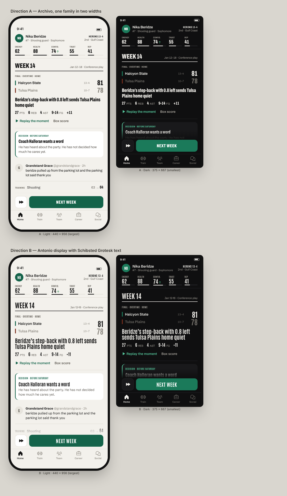

# Before the Buzzer — Plan (Phase 0)

A turn-based, text-driven basketball career simulator for iOS (Android later, same codebase).
Version 1 runs from the end of high school through draft night; the score is draft position.

This document is the contract for phases 1–5. It covers scope, architecture, the data model,
library choices, the game rules for v1, the design system, every screen, the clip system,
content, God Mode, the phase plan and the decisions taken.

> **Status:** awaiting your approval. No app code is written until you approve.
> The four design decisions are settled ([§17 Decisions](#17-decisions)); the defaults listed
> there stand unless you change them.

---

## Contents

1. [Scope of version 1](#1-scope-of-version-1)
2. [How I will build and verify](#2-how-i-will-build-and-verify)
3. [Stack and library choices](#3-stack-and-library-choices)
4. [Architecture](#4-architecture)
5. [Engine design](#5-engine-design)
6. [Game rules for v1](#6-game-rules-for-v1)
7. [Data model and save format](#7-data-model-and-save-format)
8. [Content system and localisation](#8-content-system-and-localisation)
9. [Simulation, balance and testing](#9-simulation-balance-and-testing)
10. [Design system](#10-design-system)
11. [Screens](#11-screens)
12. [2D clips](#12-2d-clips)
13. [Writing and naming](#13-writing-and-naming)
14. [God Mode](#14-god-mode)
15. [Phases, deliverables and acceptance](#15-phases-deliverables-and-acceptance)
16. [Risks](#16-risks)
17. [Decisions](#17-decisions)

---

## 1. Scope of version 1

**Built in v1**

- Player creation: name, nationality, hometown, height, position, playing style, jersey number,
  appearance, one gift, one flaw.
- Weekly turn: energy plan, 1–4 simulated games, event cards, "Next week" and "Simulate ahead".
- A full simulation of the college league (160 schools), with box scores for every game. The
  30-team pro league is simulated in the background so the draft order and team needs mean something.
- Key moments in games, resolved as 2D animated clips (~15 templates, success and failure variants,
  one signature move).
- College: recruiting and offers, grades and eligibility, conference season and tournament, the
  national tournament, and a yearly choice to declare for the draft or stay (1–4 years).
- International: under-20 and senior national teams, one tournament engine for every competition.
- Draft: scouting and a big board that moves, combine, workouts, draft night.
- Career side: agent, sponsor deals (college-legal endorsements), trust with coach, teammates and
  a beat journalist, a rival from the same class, a social feed you can answer or ignore.
- Consequences with delayed effects, and a timeline that shows cause and effect.
- Ending card with draft position (or "Undrafted") as the score, shareable as an image.
- Name editor, settings, God Mode behind a build flag, hidden style-guide screen.
- Light and dark themes, Dynamic Type, VoiceOver, reduced motion, haptics.

**Modelled in v1, built later.** The data model already holds pro contracts, salary cap fields,
league history, records, retired players and team transactions. When the pro phase arrives it adds
rules and screens, not a new save format. A finished v1 career stays in its world, so a later
version can continue it, and a new career can start in the same league.

**Not in v1** (your list of later phases): pro season and playoffs for the user, contracts and
negotiation, trades, free agency, the record book UI, money and lifestyle, life after playing,
daily scenarios, challenge careers, unlocks, the Android release pass. Also out: sound, cloud
sync, accounts, analytics, ads and purchases.

---

## 2. How I will build and verify

This session runs in a Linux cloud container, which cannot run the iOS Simulator. So that I only
report what I have seen work, I will verify on three levels:

| Level | What runs | Used for |
|---|---|---|
| Engine | Vitest in Node; headless simulation script; a terminal "play" script that drives a full career | Every engine change |
| Web render | The same app through `react-native-web` in headless Chromium (Playwright), at 375×667 and 440×956 with simulated safe-area insets, light and dark | Fast design iteration and screenshots on every UI change |
| Real iOS | A GitHub Actions macOS workflow builds a simulator build, runs Maestro flows on an iPhone SE (3rd gen) and an iPhone 17 Pro Max simulator, light and dark, and pushes the screenshots to a `ci-screenshots` branch that I fetch and review | The final screenshots in each phase report |

The repository is public, so macOS runner minutes are free.

**On your phone:** until Phase 5, every library in the plan runs in **Expo Go**. You can clone
the repo, run `npx expo start` and scan the QR code. Phase 5 (app icon, splash screen, release
build) needs a development build, made either with Xcode on a Mac or with EAS Build. The
performance check on a real device in Phase 5 needs you or a device I can reach; I will prepare a
built-in frame-time overlay and a checklist so the check takes ten minutes.

---

## 3. Stack and library choices

Versions are the current stable releases as of October 2026 (Expo SDK 57 is the latest stable
SDK; SDK 58 is in beta). All of them are bundled with or supported by SDK 57.

| Concern | Choice | Why | Rejected |
|---|---|---|---|
| Framework | **Expo SDK 57** (React Native 0.86, React 19.2, New Architecture) | Latest stable; config plugins, Expo Go for review, EAS when needed | Bare RN (more native upkeep, no benefit here) |
| Language | **TypeScript ~6.0**, `strict` plus `noUncheckedIndexedAccess`, `exactOptionalPropertyTypes` | The version SDK 57's template pins; strictest useful settings | TypeScript 7 (not yet the SDK's pinned version) |
| Routing | **expo-router 57** | File-based routing, native stack and tabs, typed routes, native form sheets with detents and swipe-to-dismiss | React Navigation used directly (more wiring for the same result) |
| State | **Zustand 5** | Small, selector-based, usable outside React by the game controller, no provider tree | Redux Toolkit (heavier for one session store), Jotai (atoms suit this less well) |
| Persistence | **expo-sqlite 57** | Ships in Expo Go, transactional writes, WAL mode, chunked saves so history is never rewritten, built-in key-value store for settings | MMKV 4 (fast, but needs a dev build; we write once per turn, so its speed advantage does not matter) |
| Validation | **Zod 4** | Content and saves validated at startup, types inferred from schemas, readable errors for content authors | Valibot (smaller, but fewer tools; size does not matter here) |
| Animation | **Reanimated 4.5** + **react-native-worklets 0.10** | UI-thread animation at 60 fps, layout animations for the feed, built-in reduced-motion support | Animated API (JS thread) |
| Gestures | **react-native-gesture-handler 2.32** | Native gestures, pressed states, swipe actions | — |
| Clips | **@shopify/react-native-skia 2.6** | GPU canvas driven directly by Reanimated shared values, no React re-renders per frame; runs on web (CanvasKit) for screenshots | react-native-svg (too slow for 11 moving objects at 60 fps), Lottie (cannot be parameterised per play) |
| Lists | **@shopify/flash-list 2** | Recycling lists for the feed, rosters, big board and box scores | FlatList (blank cells on fast scroll) |
| Icons | **phosphor-react-native 3** (+ react-native-svg 15.15) | One consistent set of ~1,200 icons in matching regular and fill weights, including basketball, barbell and film; same on iOS and Android | SF Symbols (iOS only), Lucide (no fill weight for selected states) |
| Fonts | **expo-font** with static TTF instances | Two OFL typefaces, subset to Latin plus Latin Extended for names such as Đorđević or Şengün | Variable fonts (React Native cannot set font axes reliably on both platforms) |
| Haptics | **expo-haptics** | Same API on iOS (Taptic Engine) and Android (vibrator) | — |
| Locale | **expo-localization** + an in-house typed layer (§8) | Typed keys checked at compile time, plural rules from `Intl.PluralRules`, no runtime parsing, also usable by the engine's reports | i18next (fine, but larger, and keys are only checked through extra typing) |
| Hashing | **@noble/hashes** | Audited, pure-JS PBKDF2-SHA256 for the God Mode passcode; no native module | expo-crypto (has no PBKDF2) |
| Sharing | **react-native-view-shot 5** + **expo-sharing** | Renders the career card to a PNG and opens the system share sheet, offline | — |
| Compiler | **React Compiler** (enabled through Expo) | Automatic memoisation; fewer re-renders without `useMemo` clutter | — |
| Tests | **Vitest 5** + **fast-check 4** | Fast TypeScript tests for the engine; property tests for box-score invariants | Jest (slower for pure TS) |
| UI checks | **Playwright** (web), **Maestro** (iOS Simulator in CI) | Screenshots and smoke flows | Detox (heavier set-up for the same coverage) |
| Scripts | **tsx** | Runs the simulation and play scripts on Node without a build step | ts-node |
| Lint/format | **ESLint 10** (flat config, `eslint-config-expo`, `typescript-eslint` strict type-checked) + **Prettier 3** | Standard, with custom rules for the engine boundary (§4.3) | Biome (fewer React Native rules) |

Styling is plain `StyleSheet` with typed tokens and a `makeStyles(theme)` helper. No styling
framework: the design system is ours, and a utility-class dialect would let one-off values in
through the back door.

---

## 4. Architecture

### 4.1 Layers

```
┌──────────────────────────────────────────────────────────────┐
│ app/              routes only (expo-router); thin, compose features
├──────────────────────────────────────────────────────────────┤
│ src/features/     screens and feature components (React)
│ src/ui/           design tokens, theme, components, clip renderer
├──────────────────────────────────────────────────────────────┤
│ src/state/        Zustand store + GameController (owns the session,
│                   calls the engine, auto-saves, emits UI events)
│ src/platform/     haptics, storage adapters, sharing, device info
├──────────────────────────────────────────────────────────────┤
│ src/i18n/         t(), formatters, locale catalogs
│ src/content/      typed data + Zod schemas (events, traits, names…)
├──────────────────────────────────────────────────────────────┤
│ src/engine/       PURE TypeScript. No React, no React Native, no
│                   Expo, no Date.now, no Math.random. Deterministic.
└──────────────────────────────────────────────────────────────┘
```

Dependencies only point downward. The engine defines content *interfaces*; `src/content`
implements them and is passed into the engine as a registry. The engine never imports content,
so tests can run it against small fixture content.

### 4.2 Folder structure

```
app/
  _layout.tsx                 providers, fonts, theme, splash hand-off
  index.tsx                   continue the last career or go to welcome
  welcome.tsx                 saves list, new career
  create/                     creation flow (stack)
  (game)/
    _layout.tsx               stack: tabs + pushed screens + sheets
    (tabs)/_layout.tsx        Home · Train · Team · Career · Social
    (tabs)/home.tsx  train.tsx  team.tsx  career.tsx  social.tsx
    profile/                  player card, stats, awards, timeline
    game/[gameId].tsx         game report
    moment/[momentId].tsx     key-moment sheet (form sheet)
    event/[eventId].tsx       event card (form sheet)
    bracket/[tournamentId].tsx
    draft/                    combine, workouts, draft night
    ending.tsx
  settings/                   settings, name editor, about
  godmode/                    passcode + panel (replaced by a stub in release builds)
  dev/styleguide.tsx          hidden style guide (dev builds and God Mode only)
src/
  engine/  content/  i18n/  ui/  features/  state/  platform/
scripts/
  sim/        headless simulation and balance report
  play/       terminal playthrough of a full career
  fonts/      builds static font instances and subsets
  screens/    Playwright and Maestro screenshot runners
assets/       fonts, icon, splash, court textures
docs/         design studies, balance reports
```

Tests sit next to the code they test (`*.test.ts`).

### 4.3 Enforced boundaries

- ESLint `no-restricted-imports` per folder: `src/engine/**` may not import `react`,
  `react-native`, `expo*`, `src/ui`, `src/state` or `src/content`. `src/content/**` may import
  only engine types.
- ESLint `no-restricted-globals` and `no-restricted-properties` in the engine: `Math.random`,
  `Date`, `setTimeout`, `console`.
- A separate `tsconfig.engine.json` with `"lib": ["ES2023"]`, `"types": []`, so DOM and
  React Native types are unknown inside the engine.
- `no-warning-comments` fails the build on `TODO`/`FIXME`; Prettier and lint run in CI.

### 4.4 A turn, end to end

```
UI: "Next week"
   → GameController.advance()
      → engine.beginWeek(state, plan)               pure
      → loop:
          engine.step(state) → { state, interrupt? } pure
          interrupt = KeyMoment | EventCard | Offer | CallUp | DraftChoice …
             → store.pending = interrupt → UI shows a sheet
             → user chooses → engine.resolve(state, choice)
             → save (decision boundary)
      → engine.endWeek(state) → feed entries, timeline entries
      → SaveStore.write(state)                      auto-save, every turn
      → store.setState(…) → feed animates in
```

The engine is a resumable state machine. A turn holds a cursor (`phase`, `gameIndex`,
`possession`). If the app is killed during a key moment, the same moment comes back on launch.
The result of each choice comes from a random stream keyed to that moment, so reloading cannot
re-roll it.

**Simulate ahead** runs `advance()` repeatedly with the current plan. It stops at events, offers,
call-ups, injuries, tournament starts, draft milestones, and key moments in high-leverage games
(rivalry, conference tournament, national tournament, international knockouts). Routine key
moments are resolved by the player's tendency, a profile learned from his past choices. A setting
switches this to "stop at every key moment".

### 4.5 Performance budget

| Work | Budget (iPhone 12-class, Hermes) |
|---|---|
| One week of the whole college and pro leagues (~230 games) | < 120 ms, split across frames behind a short "Simulating" animation |
| Simulate ahead, 10 quiet weeks | < 1.5 s with visible progress |
| Auto-save (JSON + SQLite transaction) | < 40 ms, off the interaction path |
| Startup to interactive, including content validation | < 1.5 s |
| Clip playback | 60 fps, UI thread only |

The headless script measures the engine numbers on every run; the device numbers are checked in
Phase 5.

---

## 5. Engine design

### 5.1 Determinism and randomness

- **PRNG:** `sfc32` (128-bit state, fast, passes PractRand), implemented in ~20 lines.
- **Named streams:** never one global sequence. Every use derives a stream from the world seed
  and a label, for example `rng("games", season, week, gameId)` or
  `rng("moment", gameId, momentIndex)`. Adding a random call in one system cannot change the
  outcome in another, so tests stay stable and saves replay identically.
- **Platform-stable maths:** `Math.exp`, `Math.pow` and `Math.log` can differ in the last bits
  between Hermes (device) and V8 (Node). Hot-path probabilities use lookup tables and basic
  arithmetic; any transcendental result is quantised. Guarantee: same seed, same build, same
  career on any device and in the simulation script.
- **Purity:** engine functions take state and inputs and return new state plus emitted
  messages. Hot loops (the possession sim) mutate local working arrays and return fresh records.

### 5.2 Engine modules

| Module | Responsibility |
|---|---|
| `core` | RNG, IDs, calendar, math tables, result types, invariants |
| `world` | World generation: nations, people, colleges, pro teams, overseas clubs, schedules |
| `player` | Creation, ratings, potential, growth, ageing, injuries, traits |
| `turn` | Week pipeline, energy plan, interrupts, simulate ahead, stop rules |
| `game` | Possession simulation, rotations, fatigue, key-moment triggers and resolution, box scores, play-by-play, clip specs |
| `college` | Recruiting, offers, academics, eligibility, polls, conference and postseason |
| `tournament` | Generic formats: groups, knockout, byes, seeding, tiebreaks, multi-turn schedules |
| `international` | Nation strength, selection, call-ups, the four-year cycle |
| `draft` | Scouting, big board, combine, workouts, team boards, lottery, draft night |
| `career` | Relationships, rival, social feed, press, agent, deals, flags, consequences, timeline |
| `pro` | League structure, contracts model, background season, minimal GM logic for offseasons |
| `save` | Save format, versions, migrations, serialisation |
| `godmode` | Pure commands God Mode can apply, and integrity marking |

### 5.3 Game simulation

Possession by possession, with a play-by-play stream. That stream is what makes key moments,
clips and believable box scores possible.

1. **Ratings.** The seven visible skills (shooting, playmaking, ball handling, defence,
   rebounding, athleticism, game sense) plus height, wingspan, position and playing style expand
   into derived ratings: three-point, mid-range, finishing, free throw, passing, ball security,
   perimeter defence, interior defence, rebounding, shot blocking, steals, foul discipline.
2. **Tactics.** Each coach has pace, three-point appetite, defensive pressure and rotation depth.
3. **Each possession:** choose the actor (usage weighted by role, rating and confidence) → choose
   the action (three, mid-range, rim attempt, post, turnover, foul drawn) from tendencies and
   the defensive match-up → resolve the shot (rating against defender, distance, contest,
   fatigue, home court, clutch context) → offensive or defensive rebound battle → assists,
   steals, blocks, fouls and free throws. Late in close games, teams foul and take quick shots.
4. **Rotations and fatigue.** In-game energy drains with minutes; the coach substitutes against
   a minutes target per role. Foul trouble and blowouts change the rotation.
5. **Roles.** Coach trust and rating set the role: **Bench** (0–8 min, sometimes did not play),
   **Rotation** (12–24), **Starter** (25–32), **Star** (32–37, more usage and the last shot).
6. **Output.** A box score (MIN, PTS, FGM-A, 3PM-A, FTM-A, OREB, DREB, AST, STL, BLK, TOV, PF,
   +/-), team totals, a play-by-play, and the user's highlight list.

Invariants, tested on every simulated game: points equal 2×FGM + 3PM + FTM; team points equal
the sum of player points; minutes add up to 200 per team (40 minutes × 5, plus overtime) in
college and 240 in the pro league; rebounds never exceed misses; no negative stats.

### 5.4 Key moments

Triggers are content (§8). The engine checks them at possession boundaries for the user's player:
late and close with the ball, a transition chance, a double team, a hard foul or knock (play
through pain?), a defensive stop needed. One or two per game; two or three in international
games and high-leverage tournament games.

The engine pauses and emits the situation: clock, score, court positions and 2–4 options. Each
option has an honest read written from the player's point of view ("You have the step. Your legs
don't."). The outcome probability blends the relevant skill, confidence, fatigue, defender,
context and traits. The engine then emits a **clip spec** (template, variant, parameters) and
continues the game from the result.

### 5.5 Confidence, streaks and form

Confidence (0–100) moves with performance against expectation (a game score compared with the
player's role and recent average) and with events. It shifts shooting and key-moment odds by up
to ±4 percentage points. Three poor games set a **slump** flag that persists until it is broken
by a good game, film study with the coach, or certain event choices. Three strong games set
**hot**, which raises usage and media attention, as well as the cost of a bad night.

### 5.6 Growth and age

```
gain(skill, week) = base × planBlocks' diminishing curve (1, 0.8, 0.6, 0.45 …)
                  × (gap to the hidden ceiling for that skill)^1.4
                  × age factor (1.0 at 18–21, falling to ~0 at 27–28, negative after 30)
                  × coach development rating × trait modifiers × fatigue penalty
                + game experience (minutes × level of competition)
```

The hidden **potential ceiling** is drawn at creation, shaped by the gift, flaw and height, and
never shown directly. Scout reports hint at it in words ("Projects as a rotation player. One
scout keeps writing 'starter?' in the margin"), and the hints sharpen as scouts see more games.

### 5.7 Traits

Three kinds: **gifts** and **flaws** (chosen at creation), and **earned** traits, unlocked by
feats tracked as counters. Example: three game-winners earns *Clutch*; ten games with ten or more
rebounds earns *Glass Cleaner*; a chronic injury from playing hurt can earn *Brittle*. A trait
changes simulation modifiers, unlocks event responses, and appears in scout reports and the feed.

### 5.8 Consequences and timeline

- **Flags** record that something happened, with provenance: `{ id, week, cause }`.
- **Scheduled consequences** hold an effect, a window (for example 2–6 weeks later), a chance,
  conditions and the cause. Each week the engine evaluates the ones that are due.
- **Timeline entries** link causes to effects when they fire ("Played through the ankle sprain,
  week 9 → chronic ankle, week 22"). A consequence that may still happen shows only a hint
  ("This might come back").

Examples: playing hurt can become a chronic injury; chasing stats lowers chemistry; skipping
class leads to an academic warning, then ineligibility; trash-talking the rival brings a
rivalry game with more key moments.

---

## 6. Game rules for v1

### 6.1 Calendar

One turn is one week. A year has ~52 turns; "Simulate ahead" passes through the quiet ones.

| Period | Turns | What happens |
|---|---|---|
| Recruiting spring (start of the game) | 3–4 | Showcase game, visits, offers, commitment (decision D3) |
| Summer | ~10 | Training, under-20 or senior tournaments (2–3 turns each), summer classes |
| Preseason (Sep–Oct) | 8 | Classes start, practice, the coach sets roles, an exhibition game |
| Non-conference (Nov–Dec) | 8 | 13 games, 1–3 a week, including an 8-team holiday tournament |
| Fall grades (mid-Dec) | — | Grade point average checked; below 2.0 means ineligible next semester |
| Conference season (Jan–early Mar) | 9 | 18 conference games, 2 a week |
| Conference tournament | 1 | Up to 4 games in a week |
| National tournament | 3 | 64 teams; two rounds per turn |
| Draft decision (Apr) | 2 | Declare, stay, or "test the waters" and withdraw by the deadline |
| Combine and workouts (May) | 3 | Measurements, drills, team workouts |
| Draft night (late Jun) | 1 | Sixty picks, two rounds; the career's v1 ending |

Draft eligibility: one year after high school and 19 during the draft year. Players leave after
four seasons at most.

### 6.2 Creation

Six short steps with a live player card at the top and "Randomise" on each step: identity
(name, nationality, hometown from that nation's city list) · body (height and wingspan with a
silhouette against a reference player; position) · playing style (shooter, playmaker, slasher,
defender, big man, each with its skill spread shown) · gift and flaw · look (portrait options,
jersey number) · review.

Gifts (examples): Clutch, Gym Rat, Floor General, Quick Learner, Iron Man, Bouncy, Silky Touch,
Natural Leader. Flaws: Injury-Prone, Hothead, Streaky, Late Bloomer (low now, higher ceiling),
Poor Student, Soft Hands, Loner, Spotlight Nerves.

### 6.3 The weekly plan

Ten blocks to place each week. The plan carries over until you change it.

| Activity | Effect | Energy |
|---|---|---|
| Train a skill (7 options) | Skill growth (diminishing within the week) | −6 per block |
| Rest | Energy and health back; injury risk down | +10 |
| Film study | Game sense; better key-moment reads for the week; can break a slump | −2 |
| Team bonding | Chemistry, teammate trust | −2 |
| Study (college) | Grades | −3 |
| Media and sponsor work | Money, reputation; small hit to coach trust if overdone | −3 |

A preview shows energy at the end of the week and the expected changes before you commit.
Low energy lowers game performance and raises injury risk.

### 6.4 College

- **League:** 160 invented schools in 12 conferences (5 major conferences of 14, 7 smaller ones
  of 12–13). National top-25 poll. Awards: conference all-teams, Freshman of the Year,
  conference and national Player of the Year, All-American teams, tournament Most Outstanding
  Player. School and conference single-game and season records are tracked.
- **Offers:** 3–4, from your recruiting rank. Each offer card shows prestige, conference,
  projected role and minutes, the coach's style, academics, development reputation, sponsor
  market and distance from home ("8,400 km from Tbilisi"). Big programme, few minutes against a
  small school where you are the star is the core trade-off.
- **Grades:** grade point average from study blocks, missed classes on road trips, and events.
  Below 2.0 at semester end means ineligible until the next check, with a summer-school way back.
- **National tournament:** 12 automatic bids (conference tournament winners) plus 52 at-large
  bids, seeded 1–16 in four regions.
- **Staying or leaving:** after each season, scouts and your agent prospect give a projected
  range; you declare, stay, or test the waters.

### 6.5 International

- **Nations:** ~45, each with a talent depth that shapes its player pool. Strong nations (for
  example the United States, Serbia, Spain, France) are hard to make; small nations (for example
  Georgia, Iceland, Estonia, Lebanon) call a good college player up early.
- **Player pool:** college and pro players, plus generated "overseas" players at invented clubs
  in real cities, so every nation can pick a believable twelve.
- **Selection:** ability only. The top twelve by a selector rating (ability, experience,
  positional balance) make the roster. Under-20 rosters use the same rule among eligible players.
- **Four-year cycle:** continental championship → World Championship → Summer Games → free
  summer. Under-20 continental championship every summer.
- **Formats** (all through one tournament engine): continental championships, 16 teams in four
  groups of four, then quarter-finals. World Championship, 32 teams in eight groups of four, then
  a round of 16. Summer Games, 12 teams in three groups, then quarter-finals.
- **Declining** a call-up costs reputation at home and national-team trust. **Scouts watch:** a
  strong tournament moves your draft stock up; a poor one or an injury moves it down.

### 6.6 Draft

- **Big board:** a consensus top 100, updated weekly. Inputs: production per 40 minutes
  adjusted for opponent strength, scouts' noisy estimates of skills and ceiling (less noisy the
  more they watch), measurables, age, tournament play, injuries and character flags.
- **Team boards:** each of the 30 pro teams has its own board: positional need, roster age, GM
  temperament (best available or need, appetite for risk, interest in international players)
  and scouting noise.
- **Combine:** height in shoes, wingspan, standing reach, vertical leap, lane agility, sprint,
  shooting drills, plus one scrimmage key moment.
- **Workouts:** choose up to six teams; each is a short sequence with one or two decisions and
  moves that team's interest.
- **Lottery:** weighted for the 14 worst teams, deciding the top four picks.
- **Draft night:** green-room invite if you are projected in the top 20. Picks are announced
  one by one, sped up when nothing concerns you. Your agent's phone lights up when a team close
  to your range calls. The selection is revealed in the team's colours, with a haptic.
  Undrafted is a real outcome.

### 6.7 Career side

- **Agent:** none until you declare; then choose from offers of different quality. Better agents
  get more workouts, better information and promotion, and charge more.
- **Deals:** college-legal endorsements (local businesses, a drinks brand, later a shoe company)
  that pay money and raise reputation but cost blocks and sometimes the coach's patience.
- **Trust scores:** coach, teammates, the beat journalist (one recurring, named character who
  remembers how you treated them), and later the GM.
- **Rival:** generated from your class at your position with a similar projection. Compared on
  the Social tab, in the feed and on draft night; sometimes on the opposing team.
- **Social feed:** fan reactions, trash talk and trending moments after games. Reply (gracious,
  funny or sharp) or ignore; each has effects.
- **Press:** post-game questions after notable games, with choices that feed relationships and
  flags.

### 6.8 Ending

The v1 career ends on draft night (drafted or undrafted), or earlier by a career-ending injury or
retirement by choice. The ending card shows draft position, team, the college line (seasons,
averages, awards, tournament runs), national-team caps and medals, the rival's result, and
God Mode's badge if it was used. It can be shared as an image. Then: "New career in this league".

---

## 7. Data model and save format

### 7.1 Entities

Entities are normalised, keyed by stable string IDs with branded types (`PersonId`, `TeamId`,
`GameId` …). People are never deleted: retired players stay in the world for history.

```ts
interface SaveFile {
  format: number;                 // save format version
  meta: SaveMeta;                 // ids, timestamps, app + content versions, seed, integrity
  world: World;
  career: Career | null;          // the user's career; null between careers
}

interface SaveMeta {
  saveId: string; createdAt: string; updatedAt: string;
  appVersion: string; contentVersion: string; seed: string;
  integrity: { godMode: boolean; log: GodModeAction[] };   // permanent once true
}

interface World {
  calendar: { year: number; week: number; phase: SeasonPhase };
  nations: Record<NationCode, NationState>;      // ranking, cycle, national-team ids
  people: Record<PersonId, Person>;              // players, coaches, scouts, agents, GMs, journalists
  teams: Record<TeamId, Team>;                   // college, pro, national, overseas club
  leagues: { college: CollegeLeague; pro: ProLeague };
  seasons: Record<SeasonId, Season>;             // current season, standings, polls, awards
  games: Record<GameId, GameRecord>;             // schedule + results (see retention)
  tournaments: Record<TournamentId, Tournament>;
  draft: DraftState | null;
  contracts: Record<ContractId, Contract>;       // pro; rookie scale used at the draft
  transactions: Transaction[];                   // signings, releases, trades, retirements
  history: HistoryIndex;                         // pointers to archived chunks
  overrides: NameOverrides;                      // name editor; originals kept
}

interface Player extends PersonBase {
  kind: 'player';
  body: { heightCm: number; wingspanCm: number; weightKg: number; hand: 'L' | 'R' };
  position: Position; style: PlayStyle;
  skills: Skills;                     // the seven visible skills, 1–100
  potential: Potential;               // hidden ceilings per skill + growth shape
  traits: TraitId[];
  condition: { health: number; energy: number; injuries: Injury[] };
  form: { confidence: number; streak: StreakState };
  affiliation: Affiliation;           // college | pro | overseas | free agent | retired
  stints: Stint[];                    // career history across teams
  eligibility: Eligibility;           // class year, draft eligibility, academic standing
  appearance: Appearance;
}

interface Career {
  playerId: PersonId;
  plan: WeekPlan;
  status: { coachTrust: number; chemistry: number; reputation: number; money: number; gpa: number };
  relationships: Record<RelationKey, number>;
  flags: Record<FlagId, FlagRecord>;
  scheduled: ScheduledConsequence[];
  timeline: TimelineEntry[];
  feed: FeedEntry[];                  // message descriptors, never rendered text
  pending: Interrupt[];               // key moment, event, offer, call-up, draft choice…
  cursor: TurnCursor;                 // resumable mid-turn position
  tendencies: ChoiceTendencies;       // used by simulate ahead
  rivalId: PersonId; agentId?: PersonId; deals: Deal[];
  scouting: DraftProfile; nationalTeam: NationalTeamRecord;
  feats: FeatCounters; ending?: Ending;
}
```

### 7.2 Retention

Full box scores are kept for the user's games, the rival's, every tournament game and every
pro game the user's future team plays. Other games keep the final score and feed season totals
for every player, then their box score is dropped at the end of the week. This keeps a world
under roughly 3 MB per simulated year; the headless script measures it and fails above budget.

### 7.3 Storage

- `SaveStore` interface with three adapters: **SQLite** (device), **IndexedDB** (web
  screenshots), **memory** (tests and scripts).
- SQLite tables: `saves(id, name, updated_at, format, integrity_badge)` and
  `chunks(save_id, key, json, updated_at)`. Keys: `core` (current world and career, rewritten
  each turn), `season:2028` and `history:2028` (written once at the season rollover, never
  rewritten).
- Auto-save after every turn and at every decision boundary, in one transaction. The previous
  `core` is kept as a backup to recover from a damaged write.
- Load: parse → run migrations from the stored `format` to the current one → validate with Zod
  → hydrate. Every migration has a fixture save and a test. A save that fails gets a designed
  error state that offers the backup.

### 7.4 Ready for the pro league and later careers

Teams, contracts, transactions, season records and history chunks already exist, and pro
seasons run in the background from day one. Adding the pro phase means adding rules and
screens. A new career can start in an existing world at its current date: the world keeps its
history, and the previous user player stays in it as an ordinary simulated person.

---

## 8. Content system and localisation

### 8.1 Content as typed data

All content lives in `src/content/<kind>/*.ts`, defined with helper functions that give type
checking while authoring and are validated with Zod at startup.

| Kind | Example fields |
|---|---|
| Events | id, category, conditions (phase, week window, flags, traits, stats), weight, cooldown, once, choices (each with visibility requirements and effects: deltas, flags, scheduled consequences, feed posts) |
| Key moments | id, trigger (clock, margin, possession type, user role), options (resolution model, modifiers, clip template and variant) |
| Play templates | actors, keyframes, ball events, branches (success and failure variants), parameter slots |
| Traits | kind, effects (simulation modifiers, event unlocks), unlock rule (feat counter) |
| Social templates | trigger (game outcome, stat line, event), tone, author archetype, reply options |
| Name pools | naming cultures (given and family names, with weights); nations map to cultures |
| Nations | code, continent, talent depth, cities, naming-culture weights, colours |
| Teams | colleges and pro teams: city, name, nickname, abbreviation, colours, mark |
| Tournaments | format definition, field rules, calendar slots |
| Deny-lists | real players, real teams and schools, used by tests and generators |

Text is never stored in content. An event refers to string keys; the English text is in
`src/i18n/en/events.ts`. A test asserts that every referenced key exists, every key is used, and
every parameter used in a string is provided.

```ts
// src/content/events/coach-heard-about-party.ts
export default defineEvent({
  id: 'coach_heard_about_party',
  category: 'coach',
  when: { phases: ['nonConference', 'conference'], flag: { id: 'went_to_party', withinWeeks: 2 } },
  weight: 3,
  once: true,
  choices: [
    { id: 'own_it',         effects: [rel('coach', +4), flag('owned_party')] },
    { id: 'blame_teammate', effects: [rel('teammates', -8),
                                      later('locker_room_leak', { inWeeks: [2, 6], chance: 0.5 })] },
    { id: 'offer_film',     requires: { trait: 'gym_rat' },
                            effects: [rel('coach', +6), plan('film', +2)] },
  ],
});
```

### 8.2 Localisation

- `t(key, params)` with compile-time key checking, interpolation, plural objects
  (`{ one, other }` resolved through `Intl.PluralRules`), and `Intl.NumberFormat` for numbers,
  money and ordinals.
- The engine emits **message descriptors** (`{ key, params }`), never strings. Saves stay
  language-independent and the feed can be re-rendered in another language.
- English only at launch. Names are written in Latin script (Georgian, Serbian or Japanese
  names are transliterated), and both typefaces cover Latin Extended.

---

## 9. Simulation, balance and testing

### 9.1 Headless simulation

`npm run sim -- --seasons 2000 --careers 5000 --policy casual --seed 42` plays seasons and full
careers without UI and writes `docs/balance/<date>.md` plus JSON, with distributions and bands.

| Metric | Target band (college) |
|---|---|
| Team points per game | 69–76 mean, s.d. 10–13 |
| Possessions per team per game | 66–71 |
| FG% / 3P% / FT% | 43–45% / 33–35% / 69–73% |
| Three-point attempt share | 36–41% of field-goal attempts |
| Turnovers per team | 11–13.5 |
| Home win rate | 58–63% |
| Final regular-season win % spread | best teams ~.85+, worst ~.15 |
| League's top scorer | 22–27 points per game |
| Pro (background) | 108–116 points, pace 97–101 |

The pro numbers matter in v1 only for believable standings, but they are tuned now.

### 9.2 Bot players for balance

Three automated policies play the user's role so the draft goal can be measured:

- **Naive:** random plans, random choices, first offer, declares at the first sign of interest.
- **Casual:** sensible plans, safe choices, the most famous school, a typical first-time player.
- **Expert:** focuses on the right skills, chooses the role over the brand, manages energy and
  grades, picks the best options in key moments, times the declaration.

Targets: **casual** is usually picked late or goes undrafted (median second round or undrafted;
first round about 20–30%; top five at most 2%). **Expert** reaches the top five in about 25–35%
of careers (capped by hidden potential) and the first round in about 80%.

### 9.3 Tests

- **Unit:** every engine module; content helpers; save migrations; i18n.
- **Property (fast-check):** box-score invariants over random rosters and seeds; tournament
  formats always produce one champion with the right number of games; growth never exceeds a
  ceiling.
- **Determinism:** the same seed and inputs give identical saves; a resumed mid-turn save ends
  the same as an uninterrupted one.
- **Golden:** a summary of a seeded 4-year career is snapshotted; changes must be deliberate.
- **Content integrity:** all content parses; references resolve (flags, traits, templates,
  string keys); no generated or authored name matches the deny-lists.
- **Design tokens:** every team colour pair passes contrast rules in both themes (§10.2).
- **CI** (GitHub Actions, Ubuntu): typecheck, lint, format check, tests, a short simulation
  smoke run with band assertions, a web export. A separate macOS workflow takes the iOS
  screenshots on demand and at the end of each phase.

---

## 10. Design system

The visual direction is **sports broadcast meets editorial**: condensed display type for scores
and headlines, tabular numerals everywhere, a warm paper and ink base, hairline rules instead of
card grids, and one accent taken from your current team's colours. A first study of the main
screen, in both type options, light and dark, small and large:



*This is a design study to choose a direction, not the final screen.*

### 10.1 Typography

Two typefaces at most. Two options were studied (decision D1); **B is chosen**:

- **A:** Archivo in two widths: ExtraCondensed for display, normal width for text. One family,
  very consistent, quieter.
- **B (chosen):** **Antonio** (display; tall, tight, scoreboard numerals) with
  **Schibsted Grotesk** (text, made for a newspaper group). More character, reads as sport *and*
  newsroom, which is the brief.

Both options are SIL Open Font License and cover Latin Extended, and in both the figures are
tabular (checked by measuring digit advances in the font files, not taken from a spec sheet).
Big Shoulders, Oswald, Saira and Teko were considered and dropped because their figures are
proportional, which would break "tabular numerals for all figures". The fonts ship as static
instances, subset by `scripts/fonts`.

| Token | Face | Size/line (pt) | Use | Dynamic Type cap |
|---|---|---|---|---|
| `scoreboard` | Display heavy, tabular | 56/52 | Game report hero score | 1.2× |
| `displayL` | Display heavy | 34/34 | Screen titles, week headers | 1.4× |
| `displayM` | Display heavy | 25/27 | Headlines | 1.6× |
| `displayS` | Display bold | 21/23 | Card titles | 1.8× |
| `stat` | Display heavy, tabular | 24/26 | Meters, stat lines | 1.4× |
| `label` | Display bold, caps, +8% tracking | 11/14 | Kickers, meter labels | 1.6× |
| `body` | Text 400 | 17/24 | Feed and card body | 2.5× |
| `bodyStrong` | Text 600 | 17/24 | Names, emphasis | 2.5× |
| `callout` | Text 400 | 16/22 | Secondary paragraphs | 2.5× |
| `subhead` | Text 600 | 15/20 | List titles, buttons in lists | 2.5× |
| `footnote` | Text 400 | 13/18 | Metadata | 2.0× |
| `caption` | Text 600 | 11/13 | Tab labels | 1.4× |

Each token maps to an iOS text style for scaling. At accessibility sizes, rows that hold several
values stack vertically instead of truncating.

### 10.2 Colour

Tokens are semantic; screens never use raw values. Measured contrast against the canvas is shown
in brackets.

| Token | Light | Dark | Use |
|---|---|---|---|
| `canvas` | `#F3F1EC` | `#0F0F10` | App background |
| `surface` | `#FFFFFF` | `#19191B` | Cards, sheets, raised controls |
| `sunken` | `#E7E4DD` | `#242427` | Tracks, inputs, avatars |
| `ink` | `#141414` (16.3:1) | `#F1EFEA` (16.7:1) | Primary text, rules |
| `inkSecondary` | `#5D5952` (6.2:1) | `#A8A49C` (7.7:1) | Secondary text |
| `inkTertiary` | `#6F6B64` (4.7:1) | `#858179` (4.9:1) | Metadata, never on `sunken` |
| `hairline` | `#DAD6CD` | `#2A2A2D` | Separators |
| `positive` | `#1B7540` (5.1:1) | `#4CC38A` (8.7:1) | Gains, wins |
| `negative` | `#C2382B` (4.8:1) | `#FF6B5E` (6.9:1) | Losses, injuries |
| `caution` | `#8F5B00` (5.1:1) | `#F2B544` (10.5:1) | Warnings, eligibility |
| `brand` | `#FF5A1F` | `#FF5A1F` | "Buzzer" orange: icon, splash, creation flow, live moments; never body text on light |
| `brandText` | `#B83A12` (5.1:1) | `#FF5A1F` (6.1:1) | Brand colour as text |
| `accent`, `onAccent`, `accentText`, `accentTint` | derived | derived | From the current team (below) |

**Team accents.** Each team defines a primary and a secondary colour. At runtime they are turned
into tokens in OKLCH: `accent` (button fill, lightness clamped so `onAccent` text reaches 4.5:1,
choosing white or ink), `accentText` (at least 4.5:1 on the canvas), `accentTint` (a 6–10%
background wash). A unit test runs every team in both themes. The study uses the Halcyon State
Herons: `#14634A` in light, `#1B7A5A` with `#56C79C` text in dark.

Court colours for clips (maple and line colours in each theme) are separate tokens, so the court
also has a dark version.

### 10.3 Spacing, radii, elevation

- **Spacing** (4-point grid): `2, 4, 8, 12, 16, 20, 24, 32, 40, 48, 64`. Screen gutter is 16 at
  widths up to 375, 20 above. Minimum touch target 44×44.
- **Radii:** `xs 2` (meter bars), `sm 8` (tags, inputs), `md 14` (buttons, cards), `full`
  (avatars, pills). Native sheets use the system radius. No other values.
- **Elevation:** light theme `e1` (hairline plus a 1 pt soft shadow) for cards on the canvas;
  `e2` (8/24 soft shadow) for the floating action dock and popovers. In dark, elevation comes
  from surface steps (canvas → surface → sunken), never shadows.

### 10.4 Motion and haptics

| Token | Value | Use |
|---|---|---|
| `instant` | 90 ms | Pressed state |
| `fast` | 150 ms | Small state changes, tab icon swap |
| `base` | 220 ms | Feed entries in, toggles |
| `slow` | 320 ms | Screen-level transitions not handled natively |
| `count` | 600 ms | Numbers counting to a new value |
| `reveal` | 450 ms | Result reveals |
| `ease.standard` | cubic-bezier(0.2, 0, 0, 1) | Default |
| `ease.enter` | cubic-bezier(0.05, 0.7, 0.1, 1) | Entering elements |
| `ease.exit` | cubic-bezier(0.3, 0, 0.8, 0.15) | Leaving elements |
| `spring.press` | damping 30, stiffness 400 | Button press |
| `spring.celebrate` | damping 14, stiffness 180 | Draft pick, game-winner |

**Reduced motion:** movement becomes 150 ms cross-fades, counters jump to the new value, clips
show the final frame and result line with a play button.

**Haptics:** selection (tabs, steppers, slider detents) · light impact (primary buttons) ·
success (made game-winner, award, drafted) · warning (injury, ineligible) · heavy impact (final
buzzer in a close game). A setting turns them off.

### 10.5 Icons, marks and imagery

- **Icons:** Phosphor only, regular for inactive and fill for active, at 16/20/24/28. Any
  missing glyph (a court, a jersey) is drawn on Phosphor's grid and stroke so it cannot be told
  apart.
- **Team marks:** a designed system rather than 190 one-off logos. Colleges get monogram marks
  (in keeping with real college athletics); pro teams get an emblem from a set of about 30
  geometric glyphs (comet, peak, wave, crown, anchor, wing…) inside one of five shapes, in the
  team's colours. Drawn with Skia, sharp at any size.
- **Flags:** small rectangular flags from an MIT-licensed SVG set, with three-letter codes in the
  broadcast style. No emoji anywhere.
- **Portraits:** illustrated faces (decision D4), described in §10.6.

### 10.6 Portraits

Every person in the game (you, teammates, the rival, coaches, the journalist, agents, GMs) has
an illustrated face. With thousands of generated people, the only way to keep them good is a
**parts system with one strict art direction**, not one-off drawings:

- **Style:** flat editorial illustration: clean vector shapes, one shadow tone and one highlight
  tone per skin colour, no outlines, no gradients, a head-and-shoulders crop with the jersey
  collar and number in team colours. Drawn as paths and rendered with Skia, sharp at every size
  from a 32-pt avatar to the ending card.
- **Parts (first set):** 6 head shapes · 10 skin tones · 8 eye shapes · 6 brow shapes ·
  8 noses · 8 mouths · 2 ear shapes · 18 hairstyles (fades, waves, curls, twists, locs,
  braids, buzz, afro, top knot, long, receding…) in natural colours · 8 facial-hair styles ·
  accessories (headband, earrings, a chain at the collar; glasses for staff).
- **Expressions:** neutral, smile, focused, frustrated, stunned, built from the same parts
  (eyes, brows and mouth change). The feed and event cards choose one to suit the moment;
  draft night gets a dedicated one.
- **Generation:** generated people get a seeded selection of parts. Skin tone uses broad,
  overlapping regional weights so every nation's roster looks varied; no other part is tied to
  nationality. Your player is built in the creation "Look" step from the same parts, with a
  Randomise button.
- **Quality control:** a hidden "portrait lab" screen renders 100 random faces at once, light and
  dark, so weak combinations are caught; certain part pairs are excluded by rule.
- **Checkpoint:** early in Phase 2 I send you a parts sheet and 24 sample faces for approval
  before building the rest of the screens on top of them.

### 10.7 Components

Text (typed variants only) · Button (primary, secondary, tertiary, destructive; regular and
compact) · IconButton · Meter · AnimatedNumber · Scorebug · BoxScoreTable · StatLine ·
FeedItem (game, decision, social, development, milestone, week header) · DecisionCard ·
ChoiceButton (with "Because you…" badges for choices unlocked by earlier choices) · SheetHeader
· SegmentedControl · Stepper · PlanBar · Tag · Avatar/Portrait · TeamMark · Flag · ListRow ·
SectionHeader · Banner · EmptyState · ErrorState · Skeleton · Sparkline · Bracket · BoardRow ·
TimelineNode · TabBar · ActionDock.

The **style-guide screen** (`dev/styleguide`) renders every token and every component in every
state. It is excluded from release builds like God Mode, and is also reachable from the God Mode
panel.

### 10.8 Accessibility

Dynamic Type through the scale in §10.1; VoiceOver labels and hints on every control, with
stat lines read as sentences ("27 points, 6 rebounds, 4 assists"); 44-point targets; contrast as
measured above; reduced motion and reduced transparency respected; focus order follows reading
order; no information carried by colour alone (wins and losses also use W/L and weight).

---

## 11. Screens

Every screen has one primary action, designed empty, loading and error states, and native
transitions (push, form sheet, cross-fade for tabs).

**Navigation.** Five tabs: Home · Train · Team · Career · Social. Profile opens from your
portrait in the header (decision D2, chosen). Sheets are native form sheets with detents and
swipe-to-dismiss, except decisions that must be made, which cannot be swiped away.

| Screen | Contents | Primary action | States |
|---|---|---|---|
| **Welcome / saves** | Saves with portrait, team, week and badges; new career | Continue | First launch: a one-line invitation and the creation button; damaged save: restore from backup |
| **Creation (6 steps)** | Live player card on top; one decision per step; Randomise | Next / Start career | Validation inline, never in alerts |
| **Home** | Header (portrait, name, team and record, 5 meters with a contextual slot, e.g. grades at risk); feed grouped by week; action dock (Simulate ahead + Next week) above the tab bar | Next week (becomes "Decide: 1 pending" when something blocks) | Empty first week teaches by doing; "Simulating…" progress; error toast with retry |
| **Train** | Weekly planner (10 blocks, steppers, stacked plan bar, end-of-week energy forecast); skills with trend; traits earned and locked, with progress | Save plan | — |
| **Team** | Segmented: Roster (roles, grades as letters, not raw numbers) · Coach (trust, style, quotes) · Schedule · Standings (conference, poll) | Context-dependent | Off-season roster empty state |
| **Career** | Draft stock (rank, trend sparkline, scout reports), agent, deals, contract (an amateur empty state until drafted), national team (status, call-ups, caps, medals) | Context-dependent | Each section has a written empty state |
| **Social** | Segmented: Feed (reply or ignore) · Press · Rival (side-by-side comparison) | Reply | Quiet-week empty state |
| **Profile** | Player card, seasons table, awards, timeline (cause → effect) | Share card | — |
| **Event card** (sheet) | Kicker, title, body, 3–4 choices; then the outcome with numbers counting | Choose | — |
| **Key moment** (sheet) | Clock and score, a still of the court, 2–4 options with reads; clip plays; result | Choose | Reduced motion: still and result |
| **Clip player** | Court, scoreboard overlay, skip, replay | Skip / replay | — |
| **Game report** | Scorebug hero, your line, key moments with replays, box scores for both teams, play-by-play highlights | Back to the week | — |
| **Bracket** | 64-team bracket (scroll and zoom, your path highlighted) or group tables and knockout | — | Pre-tournament projected bracket |
| **Combine / workouts** | Measurements against position averages; workout picks | Confirm | — |
| **Draft night** | Board, pick ticker, on the clock, phone moments, reveal | Continue | — |
| **Ending card** | Draft result, college line, medals, rival, badges | Share | — |
| **Name editor** | Search teams and players, edit names, reset to original | Save | — |
| **Settings** | Theme (system, light, dark), haptics, simulate-ahead stops, clip autoplay, about and version | — | — |
| **God Mode** | Passcode prompt; panel (§14) | Unlock / apply | Locked-out countdown |
| **Style guide** | Every token and component | — | — |

**Onboarding by doing.** No tutorial screens. Creation is short and has defaults. The first turn
is the showcase week: a coach mark on the planner ("Put three blocks into shooting"), a showcase
game with a guaranteed key moment, then the first event card. Each tip is one line, appears
once, and sits next to the control it describes.

---

## 12. 2D clips

- **Renderer:** one Skia canvas. A single Reanimated `progress` value drives everything; actor
  positions are sampled from precomputed splines inside worklets, so no React work happens
  during playback. Top-down court in feet (94×50), ten numbered circles in team colours, a ball
  with a shadow and scale for height, a contest ring on the defender, and a short trail on the
  ball.
- **Templates (~15):** fast break, pick and roll (pull-up or roll), isolation pull-up, step-back
  three, catch-and-shoot three, drive and kick, post-up, floater, alley-oop, put-back, block,
  steal and run-out, charge taken, last-second heave, free throws under pressure. Each has
  success and failure variants (make, miss, blocked, stolen, charge).
- **Parameters:** court side, start spots, jersey numbers, team colours, shot location, defender
  distance, outcome, clock and score for the overlay.
- **Scoreboard overlay:** designed in the broadcast style: team abbreviations in their colours,
  score, period, game clock and a shot clock that runs during the play; the final second triggers
  the buzzer haptic.
- **Signature move:** earned by repeated success with one move (for example a hesitation
  pull-up or a spin baseline). It gets its own template with a slow-motion replay of the final
  beat.
- **Controls:** tap to skip to the result; replay from the game report. Duration 5–10 s.

---

## 13. Writing and naming

**Voice.** Specific, dry, warm, never cruel to the player. Short sentences. Jokes come from
detail, not from punchlines. Examples:

- "Coach Halloran called it a terrible shot he would like to see eleven more times."
- "beridze pulled up from the parking lot and the parking lot said thank you" — @grandstandgrace
- "Your film session ran long. You now have opinions about the weak-side tag."
- "The academic adviser has started opening emails with 'So.'"

**Naming rules, enforced.**

- Real city and country names only for places.
- Invented leagues, teams, schools, clubs, colours and marks. Examples: *Los Angeles Comets*,
  *Halcyon State Herons* (Savannah), *Tulsa Plains Wranglers*.
- People are generated from naming cultures per nation (France draws on French and Francophone
  African cultures, the United States on many). A deny-list of real players (current and
  retired stars from the major leagues and international play) and of real team and school
  names is checked by the generator and by tests. It is best-effort and maintained by hand: no
  offline list can contain every real player, so the generator also avoids writing well-known
  surname and given-name pairs.
- Tournaments: World Championship, European Championship, Americas Championship, Asia-Pacific
  Championship, African Championship, Summer Games, Under-20 equivalents.
- The name editor writes overrides; generated originals are kept so you can reset.

---

## 14. God Mode

- **Build flag:** `EXPO_PUBLIC_GOD_MODE=1`. Metro's resolver points `@/features/godmode` at
  the real module only when the flag is on; release builds resolve a stub, so the code is not in
  the bundle at all. A CI check searches the release bundle for a sentinel string to prove it.
- **Entry:** tapping the version number in Settings seven times opens a passcode prompt. No
  other sign that the mode exists.
- **Passcode:** stored only as PBKDF2-SHA256 (random salt, about 20,000 iterations) with a
  constant-time comparison. The digits never appear in the code. Honest limit: a six-digit code
  can be brute-forced from any stored hash by someone who unpacks the app; the hash keeps it out
  of the source, and the lockout stops guessing in the app.
- **Lockout:** five wrong attempts lock the prompt for ten minutes. The lock survives restarts
  and does not lift if the device clock is turned back.
- **Scope:** unlocking is per career.
- **Panel:** edit any skill, status and hidden ceiling · set energy, health, money, grades,
  coach trust, reputation · heal or injure · force the next key moment or game result · set
  draft stock and choose the drafting team · (pro phase) force trades and contract terms ·
  trigger a call-up or any event by name · jump to any week or season · reveal hidden values and
  the active consequence flags · open the style guide.
- **Integrity:** the first action of any kind, including revealing hidden values, sets
  `integrity.godMode = true` permanently and logs the action. Such careers show a small badge on
  the saves list and the ending card and are excluded from records, rankings and achievements.

---

## 15. Phases, deliverables and acceptance

Each phase ends with a report: what was built, test and simulation results, screenshots (from
Phase 2), known gaps, and the next phase's first steps. I stop for your review after each one.

**Phase 1: Engine**
- Project scaffolding (Expo SDK 57, TypeScript, lint, format, CI); engine modules (§5); content
  schemas with enough seed content to run (name pools for ~45 nations, 160 colleges, 30 pro
  teams, tournament definitions, ~15 events, ~10 key moments, ~12 traits).
- Headless simulation with the first balance report; terminal play script.
- *Accepted when:* tests pass; a seeded career runs from creation to draft night in the terminal;
  the simulation report is inside the bands (or the gaps are explained); saves round-trip and
  resume mid-turn.

**Phase 2: Interface**
- Design tokens, theme, components, style guide; the portrait system (§10.6, with an
  approval checkpoint for its parts sheet); every screen in §11; God Mode; persistence wired to
  SQLite.
- *Accepted when:* a full career is playable in the app; screenshots of every screen, light and
  dark, iPhone SE and iPhone 17 Pro Max, critiqued and fixed; no dead buttons; every list has
  empty and loading states.

**Phase 3: 2D clips**
- Court renderer, ~15 templates with variants, overlay, signature move, reduced-motion path.
- *Accepted when:* each template renders in each variant; frame timing is measured on the web
  build and on the iOS Simulator; skip and replay work.

**Phase 4: Content and balance**
- At least 60 events, 40 key-moment situations, 25 traits, 150 social templates; tuning with the
  bots until casual and expert outcomes hit §9.2.
- *Accepted when:* content integrity tests pass; the balance report meets the targets; a
  read-through finds no repeated or filler text.

**Phase 5: Polish**
- Motion and haptics pass, accessibility pass (Dynamic Type at the largest sizes, VoiceOver
  walkthrough), app icon and splash screen, development build, performance overlay and
  real-device check with you.
- *Accepted when:* 60 fps in clips and feed scrolling on a real device; all accessibility checks
  pass; icon and splash approved.

---

## 16. Risks

| Risk | Mitigation |
|---|---|
| No iOS Simulator in this container | Web render for iteration; macOS CI for real simulator screenshots; Expo Go on your phone |
| Hermes is slower than Node for the full-league simulation | Measured budget (§4.5); work split across frames; a lighter path for games nobody watches if needed |
| Save size grows with history | Chunked saves; box-score retention rules; size budget enforced by the script |
| Real-name collisions | Deny-lists, tests, and the name editor as a backstop |
| Content quality at volume (Phase 4) | Strong schemas, a style guide for the writing, and a read-through pass |
| Illustrated faces looking cheap at scale | One strict art direction, a parts system, the portrait lab, excluded pairs, and your sign-off on the parts sheet before anything is built on it |
| Native sheets differ on Android | Form sheets are supported on both; checked again in the Android phase |
| Balance depends on many interacting systems | Bot policies and distributions from day one, not at the end |

---

## 17. Decisions

Settled on 11 October 2026:

| # | Decision | Options | Chosen |
|---|---|---|---|
| D1 | Typefaces | **A** Archivo in two widths · **B** Antonio + Schibsted Grotesk | **B** (as recommended) |
| D2 | Tabs | **A** Home · Train · Team · Career · Social, with Profile opened from the header portrait · **B** six tabs including Profile | **A** (as recommended) |
| D3 | Where the game starts | **A** Spring of the last high-school year: a showcase game, visits and offers over 3–4 turns · **B** offers on the table from the first screen | **A** (as recommended) |
| D4 | Portraits ("basic appearance") | **A** Geometric, faceless busts · **B** illustrated faces with features and expressions | **B**, built as a parts system (§10.6); I had recommended A |

Defaults I will use unless you say otherwise:

- English only at launch; the localisation layer is ready for more.
- 160 colleges, a 64-team national tournament, about 45 nations.
- Real iOS screenshots come from the macOS CI workflow (free on this public repository).
- "Simulate ahead" auto-resolves routine key moments from your tendencies and stops for
  high-leverage ones; a setting makes it stop at every one.
- Retirement by choice is possible in college, with a confirmation, and ends the career.
